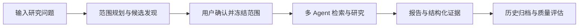

# OpenCompete

**从研究问题到可追溯的竞品分析报告。**

OpenCompete 是基于 LangGraph 与 LangChain 的多 Agent 竞品研究系统，面向产品选型、公司对比和行业研究。输入研究问题与分析对象后，系统完成范围规划、公开资料检索、并行研究和报告生成，并保存支撑结论的来源与证据。

项目提供 Web 工作台和 CLI，覆盖任务创建、范围确认、进度查看、报告阅读与历史任务管理。

## 核心能力

- **交互式范围规划**：支持候选竞品发现，确认研究对象、分析层级和维度后冻结范围，让研究围绕明确的问题展开。
- **多 Agent 并行研究**：Supervisor 拆解并分派任务，Researcher 检索公开资料、整理证据，最终汇总为分析报告。
- **多层级比较**：覆盖产品与服务、公司与组织、产业与市场，可按任务组合分析层级与维度。
- **结构化证据链**：建立 `Source → Evidence → Claim → Comparison → Report` 关系，支持引用追溯、证据查看和对比矩阵。
- **可恢复与预算控制**：通过 SQLite Checkpoint 保存执行状态，结合调用前预算预留、用量结算、有限重试和可配置备用模型管理长任务。
- **可视化研究过程**：Web 工作台通过 SSE 展示阶段、调用事件与预算消耗，集中管理研究任务、报告和模型配置。
- **研究质量评估**：提供 OpenCompete Bench，分别评价报告质量、事实支持、范围与证据校验、完成率和运行成本。

## 工作流程



研究过程由 Application Runner 统一管理。执行状态保存在 Checkpoint 中，报告与结构化产物按版本发布到本地任务目录；评测读取已有产物，保留研究与评估各自的执行边界。

## 技术栈

| 层次 | 技术与职责 |
| --- | --- |
| Web 前端 | Vue 3、Vite、Pinia、Vue Router；研究工作台与报告阅读 |
| API 与交互 | FastAPI、SSE、Rich CLI；任务管理与进度展示 |
| Agent 编排 | LangGraph、LangChain；范围确认、任务分派与并行研究 |
| 搜索与资料 | Tavily Search / Extract；公开来源检索与内容提取 |
| 数据与持久化 | Pydantic、SQLite、AsyncSqliteSaver；数据契约、执行恢复与产物管理 |
| 工程验证 | pytest、Ruff、mypy；离线测试、代码检查与类型检查 |

## 快速开始

环境要求：Python 3.11+、[uv](https://docs.astral.sh/uv/)。使用 Web 工作台还需要 Node.js 22.12+ 与 npm。

### 安装与配置

在仓库根目录执行：

```bash
uv sync --extra dev
cp .env.example .env
cp opencompete.example.toml opencompete.toml
```

在 `.env` 中填写 `OPENAI_API_KEY` 和 `TAVILY_API_KEY`，即可使用默认模型组合。模型、研究并发和预算可在 `opencompete.toml` 中调整，也可通过 Web 工作台的设置页管理。

研究、网页摘要、内容压缩和最终报告可分别配置模型，模型标识采用 LangChain 的 `provider:model` 格式。密钥保存在本机环境变量或 `.env` 中。

### 启动 Web 工作台

先安装前端依赖：

```bash
cd frontend
npm ci
cd ..
```

在仓库根目录打开两个终端，分别启动后端与前端：

```bash
# 终端 1
uv run opencompete-api
```

```bash
# 终端 2
cd frontend
npm run dev
```

访问 [http://localhost:5178](http://localhost:5178)，创建研究任务并确认范围，即可查看研究进度与最终报告。API 默认地址为 [http://127.0.0.1:8123](http://127.0.0.1:8123)。

### 使用 CLI

```bash
uv run opencompete new "比较 Notion 与 Confluence 的产品能力和公司定位" --entity Notion --entity Confluence --level product_service --level company_organization
```

系统会展示研究范围并等待确认，同时返回 `run_id`。添加 `--discover` 可启用候选竞品发现。

| 命令 | 用途 |
| --- | --- |
| `uv run opencompete new [query]` | 创建研究任务并确认范围 |
| `uv run opencompete resume <run_id>` | 恢复待确认或未完成的任务 |
| `uv run opencompete list` | 查看历史任务 |
| `uv run opencompete show <run_id>` | 查看已保存的报告 |
| `uv run opencompete evaluate --help` | 查看历史研究产物的评测用法 |

## 研究产物

每个任务按 `run_id` 保存到 `.opencompete-data/runs/`：

| 文件 | 内容 |
| --- | --- |
| `report.md` | 完整的 Markdown 研究报告 |
| `bundle.json` | 来源、证据、结论与比较的结构化关系 |
| `manifest.json` | 任务状态、产物版本与预算摘要 |
| `events.jsonl` | 脱敏的研究进度与调用事件 |
| `evaluations/` | 独立保存的评测结果 |

## 开发

```bash
uv run ruff check .
uv run mypy src/opencompete
uv run pytest -q
```

默认测试使用离线环境；真实模型和搜索接口测试通过 `live` 标记单独运行。

## 许可证

本项目采用 [MIT 许可证](LICENSE)。
