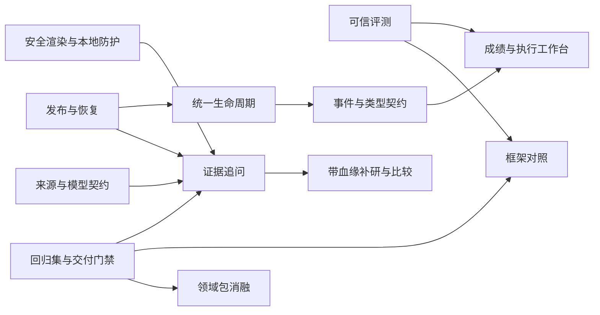

# OpenCompete 可信研究 Agent：分阶段开发计划与技术实施方案

> 日期：2026-10-01\
> 状态：建议执行顺序，未开始业务实现。\
> 目标：围绕可靠执行、证据追溯和可复现实验形成 AI Agent 工程展示；随后增加证据限定的报告追问。\
> 设计依据：[架构设计](../specs/2026-10-01-OpenCompete可信研究Agent演进-架构设计.md)。\
> 问题与调研依据：[全项目审计](../../调研/2026-10-01-OpenCompete全项目审计与Agent方案调研.md)。

## 1. 怎样选择下一步

**建议首先执行 M1 可信基线，第一项修 v3 Judge 的缺省通过。** 在分数本身不可信时优化 Prompt，无法证明有进步。安全渲染可以与评测修复并行；发布/恢复必须保持独立逻辑提交。

如果只能投入约两周，选择 M1，加一个最小的执行/评测展示页，不启动框架迁移或向量库。若可以连续投入六至九周，完成 M1 → M2 → M3，并安排限时框架对照。M4 的补研/变化比较和领域包按时间另选。

上述时长是单人有效开发日的规划估算，假设熟悉当前代码；不包含长期等待模型供应商、人工标注或招聘结果，不是交付承诺。用户尚未给定实际时间和 live 经费。

## 2. 里程碑、依赖与产物

| 里程碑 | 范围 | 估算 | 可展示的完成物 |
|---|---|---:|---|
| M1 可信基线 | T01–T04：评测、渲染、本地防护、报告发布/恢复、生命周期 | 8–12 人日 | 无效 Judge 被拒、XSS 回归、修订后恢复、准确取消/关停演示 |
| M2 工程证据工作台 | T05–T08：事件投影、执行/成绩页、来源/模型契约、复现门禁 | 7–10 人日 | 调用/尝试树、准确预算、可核验成绩、故障演示包 |
| M3 首个新 Agent 功能 | T09：证据限定追问 | 5–8 人日 | 独立问题的引用追溯、缺证拒答、固定证据快照 |
| S1 维护/替代实验 | T10：补丁台账与 Deep Agents 对照 | 2–4 人日 | 保留或迁移的实验证据与决策记录 |
| M4 可选扩展 | T11：补研/变化比较；T12：领域分析包 | 4–6 + 2–3 人日 | 新旧研究血缘、事实变化解释、可比较领域方法 |

推荐路径 M1+M2+M3+S1 约 22–34 人日；按约 20% 的集成/失败处理余量估为 27–41 人日。M4 不包含在其中。不能把所有候选默认打包成一个不可结束的大重构。

依赖关系：



T08 的测试基础设施尽早启动，固定质量实验在 T01 通过后执行。T07 的模型装配去重不阻塞独立 bug 修复。所有新增文件名是建议的落点，实施时先检查是否已有等价职责，避免重复模块。

## 3. T01：严格评测、真实溯源和费用（ER-01/02/09）

**改动区域：**

- 修改 `src/opencompete/evaluation/competitive_v3_judge.py`、`competitive_v3_models.py`、`competitive_v3_service.py`、`competitive_v3_race.py`。
- 复用 `competitive_judge.py` 与 `competitive_service.py` 的严格 ID 校验/聚合；需要共用时新增小型 `validation.py`，不复制整套 Judge。
- 修改 `tests/opencompete/evaluation/test_competitive_v3_path.py`、`test_competitive_v3_parity.py`；新增 `test_judge_output_integrity.py`、`test_evaluation_provenance.py`。

**输入/输出：**输入固定 case、已有 Report/Bundle、Judge 输出；输出严格结果状态、完整 ID 评判、真实哈希/模型身份、每次评测 usage 增量。历史结果保持原样，读取时根据协议和缺失身份给出资格原因。

实施顺序：

1. 把 F01/F02 转为失败测试：空维度、缺 criterion、重复/未知 ID、非法数值、遗漏 Target/关系均不能评分。
2. 明确每类分母与空集行为；移除中性补分、默认 supported、固定 Unknown/矛盾值。
3. 向 FACT 注入有限且足够的 Evidence/Source 上下文，区分原文/摘要；完善单批与分批完整性校验。
4. 消除占位 provenance；记录当前 Prompt/输入的真实哈希、Judge 路由与代码版本。不能验证的官方锚点标未知。
5. 以调用前后快照计算 usage delta；未知价格为 null；长报告超限显式失败或记录已批准的分批协议。
6. 同一历史结果不覆盖，错误历史不能自动升级成可信结果；更新 README 的 v3 与命名说明。

**验证：**

```bash
uv run pytest -q tests/opencompete/evaluation
```

**完成条件：**空 Judge 无分数；错误证据不能因字段缺失通过；两案例批次费用不重复累计；哈希改变可识别；official/local 命名不混淆；所有旧公式与协议特征测试通过。此任务不需要真实研究，可先用固定输出验证，再在显式预算下运行真实 Judge 校准。

## 4. T02：安全报告渲染与本地控制面（ER-03）

**改动区域：**

- 新增 `frontend/src/utils/renderReport.js`；修改 `pages/ReportPage.vue` 和 `frontend/package.json`/锁文件。
- 修改 `src/opencompete/api/server.py`、`routes.py`；若来源策略需要独立函数，新增 `api/local_access.py`。
- 新增 `frontend/src/utils/renderReport.test.js`、`frontend/tests/report-security.spec.js`、`tests/opencompete/api/test_local_access.py`。

**技术选择：**保留 Marked，增加 DOMPurify；使用既有 TrustedHostMiddleware。Vitest 用于确定性转换，Playwright 用于真实浏览器安全行为。先建立这两个最小测试入口，T08 再纳入统一 CI。

实施顺序：

1. 在当前版本复现恶意标签/事件属性/危险 URL；明确合法表格、引用、代码块的保留行为。
2. 抽取单一渲染出口，在安全 token/节点层处理引用，最终净化；禁止净化后再插入不可信 HTML。
3. 默认回环绑定、明确 Host 白名单、精确 Origin/请求上下文规则；GET 不推进研究。
4. 保留已批准的显式 Key 查看，验证 no-store、离页清理和日志不泄漏；普通设置响应不回显 Key。
5. 对 Vite 代理与正式同源各跑一组允许/拒绝用例；不把远程监听作为本地模式的隐式选项。

**验证（脚本在本任务建立后执行）：**

```bash
npm --prefix frontend run test:unit -- src/utils/renderReport.test.js
npm --prefix frontend run test:e2e -- tests/report-security.spec.js
uv run pytest -q tests/opencompete/api/test_local_access.py tests/opencompete/api/test_api_settings.py
npm --prefix frontend run build
```

**完成条件：**浏览器未执行恶意 HTML；引用/表格完整；拒绝非法 Host/Origin；凭据查看仍符合已确认交互。当前仅承诺 IPv4 loopback；需要 IPv6 时先修锁定 Starlette 的兼容问题并复验。

## 5. T03：报告门禁与发布/恢复修订（ER-03/04/07）

**改动区域：**

- 修改 `src/opencompete/report_publication_gate.py`、`materialize.py`、`application.py`、`models.py`。
- 修改 `persistence/repository.py`、`persistence/reconciliation.py`、`persistence/models.py`。
- 修改 `tests/opencompete/test_report_publication_gate.py`、`test_materialize.py`、`test_application.py` 和 `persistence/test_reconciliation.py`；新增 `persistence/test_publication_revision_recovery.py`。

**输入/输出：**输入上游完整报告、可信证据、执行快照；输出合法叙事、发布原因、执行锚点、业务 revision。执行状态不得被普通离线报告操作悄悄推进。

实施顺序：

1. 添加普通 `capabilities` 文本不触发硬泄漏、真正内部 ID/秘密仍被阻断的正反例。
2. 区分安全阻断、生成失败、质量提示；移除对正常成功叙事的硬替换。
3. 完成“完成→重物化→新 Runner 恢复”的失败测试；同时写真实损坏/非法超前版本仍拒绝的测试。
4. 实施设计第 6.2 节的执行锚点；completed/partial 均核验 Scope/执行锚点和无 next/interrupt；Checkpoint 真正缺失仅允许 history-only，不能绕过待确认保护。
5. 明确旧格式迁移，禁止凭借任意 publication_kind 放行；在无活跃执行/无 pending checkpoint 时才允许离线重物化。
6. 逐一在文件发布窗口注入进程退出，验证 Manifest 最后更新和恢复规则。来源实际时间由 T07 接续传播；本任务至少禁止重物化伪造已知时间。

**验证：**

```bash
uv run pytest -q tests/opencompete/test_report_publication_gate.py tests/opencompete/test_materialize.py tests/opencompete/test_application.py tests/opencompete/persistence tests/opencompete/test_recovery_process.py tests/opencompete/test_secret_persistence.py
```

**完成条件：**成功报告完整性不回退；合法修订可处理；未知冲突不被吞掉；进程退出、预算耗尽、单研究单元失败、确认点和秘密扫描均通过。

## 6. T04：统一生命周期与创建准入（ER-06）

**前置决策：**批准“用户取消是终态、服务关停保留可恢复状态”，明确旧 cancelled/awaiting 混合状态的迁移规则。本任务不默认新增用户暂停功能。

**改动区域：**`application.py`、`api/tasks.py`、`api/routes.py`、`api/schemas.py`、`persistence/repository.py`、`cli.py`；测试 `api/test_actual_run_lifecycle.py`、`api/test_run_lifecycle.py`、`test_application.py`，新增 `api/test_create_request_idempotency.py`。

**输入/输出：**操作原因、预期 revision、request_id、任务内容 → 唯一 run、明确接收/拒绝结果和安全生命周期状态。

实施顺序：

1. 用状态转换表统一 API/CLI/Application；只读 inspect 永不推进 Graph。
2. 同 request_id 的进程内互斥区中先查已提交结果；只有新请求才预留容量并初始化，失败释放，容量不足不遗留幽灵任务。
3. 回复前耐久保存 request_id、规范化输入哈希和完整初始委托；重复请求先于容量检查返回已创建 run，不同内容拒绝；重启后仍可定位并显式继续。
4. 覆盖同 ID 并发、落盘后后台启动前退出、响应丢失、确认重复、取消与恢复竞争、正常关停/强杀；区分未发请求的预算释放和已发请求的保守结算。

**验证：**

```bash
uv run pytest -q tests/opencompete/api tests/opencompete/test_application.py tests/opencompete/test_cli.py tests/opencompete/test_recovery_process.py tests/opencompete/test_secret_persistence.py
```

**完成条件：**同一请求最多创建一个可见任务；取消不被复活；服务重启后恢复同 run；所有入口遵循同一状态契约。多进程竞争不在本任务支持范围内。

## 7. T05：类型化事件和可重放预算投影（ER-05）

**改动区域：**`budget.py`、`api/events.py`、`api/schemas.py`、`frontend/src/stores/runs.js`、`frontend/src/api/client.js`。新增 `frontend/src/utils/runProjection.js` 及对应测试；生成类型放 `frontend/src/api/schema.d.ts`。

**输入/输出：**持久事件流/日志游标/权威预算快照 → 可重建的运行视图。日志游标不是账本水位，投影不可改变 ledger 或 run 状态。

实施顺序：

1. 固化事件判别联合与必须字段，包含 seq/attempt_id/真实 token；明确旧事件缺字段的兼容规则。
2. 把 F08 的重复/并行反例转为测试，加入乱序、缺帧、取消、失败、切页和同 run 多确认阶段。
3. 从 store 抽纯 reducer；从零重放清空，断点续播保持游标；按 attempt_id 管理 holds。
4. 第一期预算总额只用权威 ledger 快照，事件触发合并刷新并展示单次调用，不与快照混加。测试 ledger 提交后事件写出前查询，以及事件写入失败；缺失快照显示待刷新，不制造精确数字。
5. 收紧 API Pydantic schema，通过 OpenAPI 生成类型；对 SSE 另导出事件 schema；启用关键文件 checkJs 或局部 TS。

**验证：**

```bash
npm --prefix frontend run test:unit -- src/utils/runProjection.test.js
npm --prefix frontend run typecheck
uv run pytest -q tests/opencompete/api tests/opencompete/test_budget.py tests/opencompete/test_callbacks.py
```

**完成条件：**相同历史无论一次播放、分批播放或重复发送，最终投影一致；并行 attempts 不相互覆盖；结束后的预算与持久账本一致。不得以 UI 累计值替代预算准入。

## 8. T06：执行检查器与只读成绩页（ER-02/05/09）

**改动区域：**通过 `ApplicationRunner` 增加查询用例，必要时新增 `src/opencompete/queries.py`；修改 `api/routes.py`/`schemas.py`、`RunDetailPage.vue`、`ReportPage.vue`、`DashboardPage.vue`。新增 `components/ExecutionInspector.vue`、`components/EvaluationPanel.vue`。

**输入/输出：**已保存 run/事件/评测 → 调用/尝试树与具有真实身份的评测视图。读取不启动研究或 Judge。

实施顺序：

1. 展示 execution/unit/call/attempt、主备模型、失败类型、耗时、预算与恢复点；用安全摘要解释调用目的。
2. 展示已保存 RACE 四维/Overall、FACT、硬门禁、完成率口径、独立成本；未评测为 not_run，不是 0。
3. 展示数据集/Judge/协议/产物 revision/hash；不匹配结果明确过期或不可比较。
4. 完整事件按需读取，默认摘要不受“最近 200 条”限制误导；离线回放有明显标记。
5. 添加“创建→确认→研究→报告”“服务重启→检查→显式恢复”“失败→备用→结束”浏览器闭环。

**验证：**新增 `tests/opencompete/api/test_evaluation_queries.py`，以及 `frontend/tests/run-lifecycle.spec.js`、`evaluation-view.spec.js`；运行它们、前端 build 和默认后端门禁。

**完成条件：**面试者可以用一个 run 回答“研究如何分派、哪个请求失败、是否重放兄弟、花费在哪、分数是否有效”。无需 LangSmith 账户，不展示原始 Prompt 或隐藏思维链。

## 9. T07：来源时间与模型装配收拢（ER-07/08）

这是两个可分别提交的小改动，不要求同一天完成。

**来源子项：**修改可信工具 artifact 契约、`materialize.py`、Source/Evidence 模型；测试 `test_tavily_extract.py`、`test_materialize.py`、`test_upstream_prompt_injection.py`。新增 `test_source_provenance.py` 验证实际采集时间跨重物化保持不变、旧数据未知时间不伪造、summary 不冒充 raw_excerpt。

**模型子项：**收拢 `deep_researcher.py`、`scope_planning.py`、`providers.py`、`extractors.py` 的重复装配。纯 Runnable 组合留在 `open_deep_research/model_routing.py`，角色配置在应用适配层。上游不能反向导入 OpenCompete。

技术步骤：

1. 用现有四类调用做行为特征测试，固定 retry/fallback、tools、structured/plain-text preparation 顺序。
2. 只抽取相同配置/调用装配，不改 Prompt 和研究图职责。
3. 保留 SDK retries=0、纯文本流式、独立报告/Extractor token 上限、五次自动尝试和同 call_id。
4. 如增加模型价格映射，记录版本、实际路由及未知价处理；不伪装供应商账单。

**验证：**

```bash
uv run pytest -q tests/opencompete/test_model_routing.py tests/opencompete/test_providers.py tests/opencompete/test_extractors.py tests/opencompete/test_scope_planning.py tests/opencompete/test_tavily_extract.py tests/opencompete/test_upstream_failure_isolation.py tests/opencompete/test_upstream_callback_propagation.py
```

**完成条件：**行为与原特征相同，失败分类/重试/预算不漂移，可信来源字段真正来自采集时刻。涉及持久化与上游的额外门禁按第 15 节执行。

## 10. T08：固定回归集、故障演示与交付门禁（ER-09）

**改动区域：**`benchmarks/opencompete/v3`、`tests/opencompete/helpers`、新增 `scripts/demo_recovery.py`、`scripts/export_demo_bundle.py`、`.github/workflows/quality.yml`、README 和中文演示文档。

实施顺序：

1. 在不缩减 FACT 目标的前提下迁移三个不同领域和一个缺证案例；记录 Reference/Criteria/来源身份，保持 provisional 标签直到人工审核。
2. 新增固定缺陷变体：无证据强结论、错价格/地域、伪引用、漏 Unknown。明确预期失败维度，避免通过更宽松评分掩盖缺陷。
3. 复用已有 fake Provider 与跨进程 helper，构建断流、限流、主备、兄弟失败、预算耗尽、进程退出的演示。脚本默认离线，真实调用必须显式启用。
4. 导出白名单：中文说明、报告、必要 Bundle、来源/评测身份、安全事件摘要；排除 `.env`、TOML 实值、Checkpoint 和原始上下文。真实用户查询/商业内容需确认可公开；默认发布合成案例。
5. CI 用 `uv sync --frozen --extra dev`、后端门禁、`npm ci`、前端类型/单元/E2E/build；无 API Key 也能通过。修复 Dependabot 重复 updates，按确认支持的环境加矩阵。
6. fresh live 使用显式批准的案例和费用上限，形成质量/成本/时延基线；不得从散落历史目录拼接一个“完成率”。

**验证：**在新临时数据目录从零完成离线脚本，跨进程恢复后关键断言一致；产物白名单与秘密哨兵扫描通过。自动 CI 不运行 live。

**完成条件：**其他开发者可按文档复现；每个演示可定位源码、测试和产物。新质量数字必须有报告/Bundle/评测输入哈希及样本分母。文档修复 README 的实际调用时机、显式 Key 查看和 v3 描述。

## 11. T09：证据限定的报告追问（CAND-01）

**启动条件：**该候选功能被选择进入实施；T02/T03/T07 已通过；追问预算、数据保存/删除语义已冻结。

**建议文件：**

- 新增 `src/opencompete/answering.py`、`answer_models.py`；必要的原子存储函数放 `persistence/answers.py`。
- `ApplicationRunner` 暴露创建/读取追问用例；API 新增请求/响应 schema，前端新增 `components/ReportQuestionPanel.vue`。
- 新增 `tests/opencompete/test_answering.py`、`persistence/test_answer_repository.py`、`api/test_report_questions.py`、`frontend/tests/report-questions.spec.js`。

**输入/输出：**固定版本 Bundle/报告快照、问题与独立预算 → AnswerArtifact、Evidence 引用、缺证说明、安全调用记录。原报告和 Bundle 不变。

实施顺序：

1. 建立 answer request_id 去重、输入版本冲突与快照哈希测试。
2. 先实现按实体/维度/Claim/Evidence 的确定性检索；建立“整篇报告直接回答”的对照，不预装向量库。
3. 通过现有 LangChain 模型运行时一次生成结构化回答，校验引用集合；无法支持的结论拒答或明确推断。
4. 独立 operation_id、budget 和 ledger 身份，五次窗口仍成立且预算不能超过应用上限；操作纳入统一容量和凭据轮换门禁，不能复用已完成 run 的剩余预算静默付费。
5. 答案与输入快照原子保存，首期问题独立，不引入多轮上下文；活动追问阻止删除父 run，停止并等待收尾后才能级联删 answers，迟到回调不得重建目录。
6. 建立固定问题集：直接事实、跨 Claim 比较、缺失事实、矛盾证据、提示注入、旧 revision。语义支持率和引用存在率分开测。

**验证：**运行新增四组测试和全部门禁；网络 spy 确认没有 Tavily 调用，输入 Bundle/report 哈希前后不变。模型质量实验另外显式运行，不把 fake answer 当质量证明。

**完成条件：**用户能沿回答引用回到真实 Evidence；无法回答时没有编造；刷新后答案可读；失败尝试和花费可追溯。后续只有测得检索规模/召回瓶颈才考虑 FTS5/向量检索。

## 12. T10：上游维护与 Deep Agents 限时对照（REQ-013/ER-09）

**启动条件：**可信评测已经修复；允许进行隔离实验；若需付费比较，另行给定真实调用上限。

**产物：**新增中文上游补丁台账、隔离实验脚本/环境锁文件和 ADR；不修改正式依赖 `uv.lock` 或默认研究入口。隔离目录使用既有忽略规则覆盖的 `.tmp-*`，可复现脚本/非秘密配置另归档在受控实验目录。

实验步骤：

1. 将上游六文件差异映射到需求和特征测试，区分必须保留、可移到适配层、已不需要的补丁。
2. 阅读并锁定 Deep Agents 版本/许可证/依赖，验证可禁用默认文件与执行能力；不能禁用则提前结束。
3. 用相同 Scope、公开工具、模型、预算执行离线故障矩阵；验证无平台依赖、秘密不落盘、逐调用重试和兄弟保留。
4. 若硬门禁通过，再使用 T08 固定案例做小规模配对研究；记录维护/安装负担与性能，不只看最终文字好不好。
5. 产出“保留 / 扩大实验 / 迁移”决策；迁移需单独新规格。2–4 人日结束即记录结果，不把实验变成无限重写。

**完成条件：**有明确淘汰条件和可复现数据；保留当前框架也算有效结论。上游归档是评估触发条件，不是已经证明新框架更好的证据。

## 13. T11：带血缘的补研与变化比较（CAND-02，可选）

**建议文件：**新增 `followups.py`、`change_analysis.py` 及必要的领域模型；复用 Runner 创建新 run；新增对应 API/前端对话框与测试。

实施顺序：

1. 从缺证问题生成补研草案：范围、缺口、预算、父 run/version/hash；不自动发请求。
2. 用户确认后创建新 run，并保存父输入快照；不复活/改写旧 run。
3. 复用研究内核处理批准后的范围，最多一个补研窗口。新的目标/维度要走范围确认。
4. 用实体/维度/地域/有效时间匹配证据，生成独立 ChangeArtifact；区分事实变化、来源变化和表述变化。
5. 子 run 独立保存父输入快照，删除父 run 不级联删子 run，提前说明副本保留，父链接显示原任务已删除。验证父任务删除/重物化、两个范围不可比、预算耗尽、重复提交、新任务失败时父产物仍完整。

**完成条件：**能解释一条变化的前后证据；全部新费用属于新操作；不会自动递归补研。定时监测不在本任务中。

## 14. T12：领域分析包与方法消融（CAND-03，可选）

**建议文件：**在现有 `analysis.py`/Analysis Pack 模型旁增加声明式配置和案例；只有单文件职责确实超出才建立 `analysis_packs/`。不创建通用 Skill 执行器。

选择一个与展示目标相关的主题，例如 AI 开发工具选型；定义维度建议、应有证据、事实/推断分界和版本。核查内容来源与许可证，不复制缺许可的第三方 Prompt。

先写“包只能建议、不能改冻结范围/预算/工具权限”的测试，再做无包/有包的固定案例对照。仅在证据质量或任务遵循改善且成本可接受时保留；没有稳定收益时删除该包，不能为新增 Skills 数量保留。

## 15. 全局质量、提交与交付规则

### 15.1 每个逻辑改动的完成门禁

1. 开始前读取相关规格/源码和最近规则，执行 `git status --short --branch`、上游差异检查。
2. 问题修复先复现并写有意义的失败测试，再最小实现；不为纯文案/CSS编写镜像式测试。
3. 涉及代码的提交运行：

```bash
uv run ruff check .
uv run mypy src/opencompete
uv run pytest -q
git diff --check
git diff --stat upstream-b764481f
git diff upstream-b764481f -- src/open_deep_research
```

4. 前端行为增加对应单元/浏览器测试，执行 typecheck/build。测试只跑必要支持矩阵，不为重复验证无变化代码浪费真实请求。
5. 持久化改动至少覆盖：进程退出、确认点、预算耗尽、单 Researcher 失败、产物对账、SQLite/全部产物秘密哨兵扫描。
6. 上游变更写 REQ、适配器不足原因、原行为特征测试和核心差异；禁止顺带重写无关 Prompt/Provider/Legacy。
7. 每个完成的独立逻辑变更在本地 main 提交，中文 conventional 标题；涉及不同长期边界时按上游适配→核心→前端→文档顺序。半成品不提交，未经用户明确要求不推送。
8. 检查 staged 文件、秘密模式和忽略目录，提交后检查工作区；产物与本机配置不入库。

### 15.2 需求覆盖

| 需求 | 主要任务 |
|---|---|
| ER-01/02 | T01、T06、T08 |
| ER-03 | T02、T03 |
| ER-04 | T03、T04 |
| ER-05 | T05、T06 |
| ER-06 | T04 |
| ER-07/08 | T07；T03 先修时间不变约束 |
| ER-09 | T06、T08、T10 |
| CAND-01/02/03 | T09 / T11 / T12，选择后实施 |

### 15.3 推荐的五分钟演示

1. **约一分钟：**输入一个具体比较任务，查看真实范围草案并确认；解释为什么工具不能扩大范围。
2. **约一分钟：**回放一个有主备切换或兄弟失败的 run，展开 call/attempt、预算与 checkpoint。明显标记历史回放。
3. **约一分钟：**查看完整报告与证据链，说明 Unknown、partial 和来源时间。
4. **约一分钟：**打开同一版本的评测，展示身份、分母、质量与事实分离；用一个故意错误样本说明门禁会拒绝。
5. **约一分钟：**针对结论追问，查看证据引用和缺证拒答；若尚未完成 T09，就展示跨进程恢复而不伪装追问已上线。

可写入项目经历的主张必须绑定已完成任务、具体测试和产物。当前可以说明已有的 Supervisor/Researcher、SQLite 恢复、预算与单调用重试；“质量提升 X%”“成本降低 Y%”“新 Agent 功能完成”须等相应实验/实现真的完成后再写。
