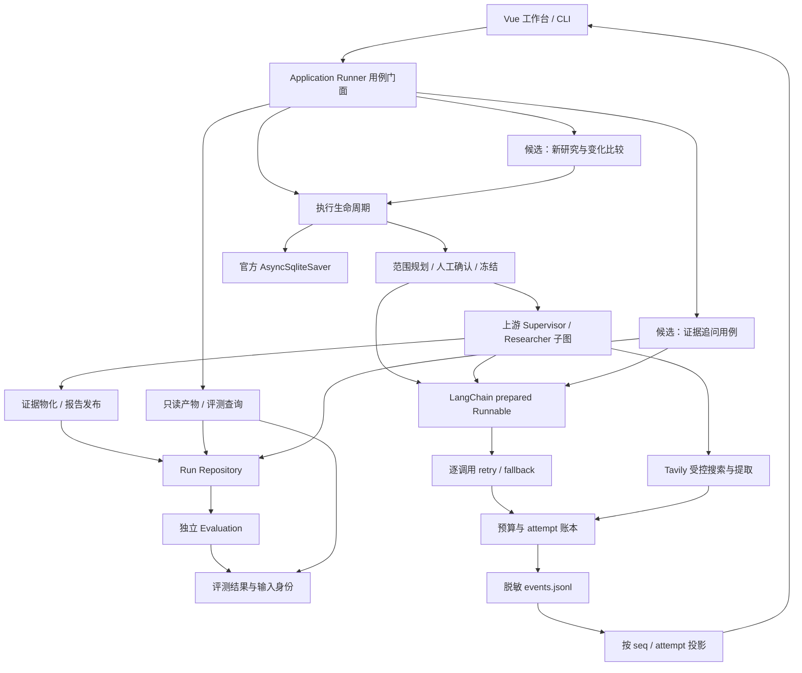

# OpenCompete 可信研究 Agent 演进：架构设计

> 日期：2026-10-01\
> 状态：供评审的设计建议；不是已批准实施规格。\
> 已确认目标：突出 AI Agent 工程能力与求职展示。\
> 基线：`227d354d3f24ebdc2d72e73c3fb43eaaf22f9145`。\
> 依据：[全项目审计与成熟方案调研](../../调研/2026-10-01-OpenCompete全项目审计与Agent方案调研.md)。\
> 执行切片：[分阶段开发计划](../plans/2026-10-01-OpenCompete可信研究Agent-分阶段开发计划.md)。

## 1. 目标、范围与需求状态

目标产品仍是本地单用户竞品研究工具，核心价值是“可靠执行 + 可核查证据 + 可复现实验”。工程展示必须来自实际机制和产物，不能把引入库的数量、Agent 角色数量或未经验证的分数当成果。

本设计分四个可独立交付的子项目：

1. **可信基线**：评测严格性、报告安全、完整叙事、发布与恢复语义。
2. **可靠执行工作台**：事件投影、执行检查器、只读成绩页和可复现故障演示。
3. **证据驱动的新功能**：报告追问优先，手动补研/变化比较随后。
4. **维护与替代实验**：上游补丁台账、依赖边界、Deep Agents 对照。

其中前两项主要修复/完善现有已确认需求；第三项是用户“探索下一步”范围内的候选设计，不是已确认功能订单；第四项不等于批准迁移框架。本轮只交付设计与计划，不修改业务实现或运行付费评测。

### 1.1 成功标准

- 不完整 Judge 输出不能产生有效 RACE/FACT，结果可以追溯到真实输入与模型身份。
- 正常报告不因普通英文词被替换；不可信 HTML 在浏览器中不能执行。
- 同一事件重复/重连/并发均不改变最终成本；恢复不重跑成功兄弟。
- 合法终态报告重物化后可读取/处理恢复命令，不能被误判为未知版本冲突。
- 候选追问功能能给出 Evidence 级引用，缺证时拒答，原报告与 Bundle 哈希不变。
- 展示用样本能分清离线模拟、历史资料、fresh live 与有效评测，不编造质量提升。

### 1.2 保留与非目标

保留 Supervisor/Researcher 拓扑、LangChain 多模型能力、官方 SQLite Saver、逐调用预算与重试、完整叙事和结构化 Bundle 的分离、公开 HTTP/HTTPS 来源、默认关闭遥测、单进程单 run 互斥，以及 Web 和 CLI 两个入口。

近期不做多租户/RBAC、云服务、分布式队列、任意 MCP、浏览器/代码执行、跨任务自动事实记忆、知识库文件上传、自动定时研究和全量 Agent 框架重写。它们是独立产品边界，不作为“未来扩展”预先加入接口和存储。

## 2. 可测试需求

`REQ` 引用 2026-07-15 主规格；`ER` 表示本轮对既有需求的验收细化；`CAND` 表示尚未批准实施的功能建议。不得将 CAND 写成已交付或已确认。

| 编号/来源 | 必须满足的行为 | 场景与判定 |
|---|---|---|
| ER-01；REQ-012/021/022 | 评测器必须拒绝缺失、重复、未知 ID、非法评分或不完整关系输出 | 给空 dimensions 或空 target/relationship 评判，返回 invalid_output，score=null、不可比较 |
| ER-02；REQ-004/012/021 | 评测必须绑定有效的报告/Bundle/数据/Prompt/代码哈希与 Judge 身份 | 改变报告任一字符，旧结果被标记不匹配；占位哈希不能被标成 verified |
| ER-03；REQ-011/020 + Web 规格 | 用户报告保持完整，渲染边界阻断主动内容 | 正常 capabilities 术语保留；恶意 HTML 不执行；引用/表格仍可读 |
| ER-04；REQ-007/008/013 | 执行状态与离线发布修订分别判断，不扩大冲突豁免 | 终态报告重物化后 resume 不新增研究；真正损坏/不明超前版本仍拒绝覆盖 |
| ER-05；REQ-006/009/014 | UI 只投影持久事件，支持重复与断点续播 | 同序号重复、同节点并行 attempts、刷新后的预算与账本快照一致 |
| ER-06；Web 显式恢复需求 | 创建准入与取消/关停/强杀/恢复形成单一应用层契约 | 容量满不遗留未返回的 run；取消不可被普通 inspect 恢活；强杀后允许显式恢复 |
| ER-07；REQ-004/011 | 实际抓取时间与物化时间分离，证据类型明确 | 离线重物化不刷新 accessed_at；模型摘要不能标为原文摘录 |
| ER-08；REQ-015/018/019 | 四类模型调用共享 prepared Runnable 重试边界和安全事件 | 相同错误序列在规划/发现/研究/提取器中均不超过五次自动真实尝试 |
| ER-09；本轮用户目标 | 提供可复现的正常/失败/恢复/缺证演示与独立质量结果 | 新环境按文档复现离线流程，无秘密；live 结果有实际 run 身份，失败样本不消失 |
| CAND-01；报告追问 | 用户可对固定产物提问，仅依据该版本证据回答 | 回答包含有效 Evidence 引用；问未覆盖事实得到证据不足；无搜索请求 |
| CAND-02；补研与比较 | 用户可确认一次有预算的补研/重跑，并比较新旧产物 | 创建新 run 和父版本锚点；旧产物不变；新增对象必须重新确认范围 |
| CAND-03；领域分析包 | 用户可选择有版本的方法包生成范围建议 | 包不能私自扩大冻结范围、开放工具或覆盖事实；不同包的效果能配对评测 |

ER-06 中“用户取消终态、服务关停可恢复”是推荐的统一语义，当前核心与 Web 存在分歧，实施该切片前须把这项决策落入确认规格和旧数据兼容测试。ER-08 不改变用户主动 resume 可开启新自动窗口的既有行为，ledger 保留累计 attempt。

## 3. 总体方案比较

| 方案 | 核心思路 | 收益 | 代价与结论 |
|---|---|---|---|
| A：仅修缺陷和文档 | 保持结构，修 F01–F08，补基础测试 | 最快得到可信演示 | 新 Agent 功能不足；适合仅有约两周的情况 |
| B：渐进可信研究工作台 | A + 清晰用例边界 + 执行/评测展示 + 一个证据追问功能 | 兼顾 Agent、后端、全栈和评测能力；能逐段验收 | 推荐；对照实验独立，避免大迁移阻塞交付 |
| C：迁移 Deep Agents/其他平台 | 重新接入计划、Skills、上下文、记忆与工具系统 | 可复用仍维护的完整 harness | 当前功能与安全契约并不自动迁移；先做限时实验，不能直接采用 |

由于 Open Deep Research 已归档，B 必须包含维护责任和退出策略；仅“保留上游以便持续获得修复”已经不是充分理由。保留当前内核的依据是已有可运行行为、测试和领域契约，而不是代码量本身。

## 4. 逻辑架构与依赖方向

下图中实线是推荐主结构；追问/补研/比较属于 CAND 功能，批准后才增加。



### 4.1 重构策略

- **Application Runner 继续是入口门面。** 只在相应用例修改时抽取执行生命周期、发布操作和只读查询函数。现有 `ApplicationGraph`、Repository、模型边界足够使用，不先创建新的通用端口框架。
- **模型装配只收拢重复部分。** provider-neutral 的 Runnable 组合保留在既有 `open_deep_research/model_routing.py`；OpenCompete 的角色配置和进程内连接留在应用适配层。上游不导入 OpenCompete 模型。
- **图拓扑不随重构变化。** 保留真正嵌入的子图，不把整个研究过程包装成不可恢复的单节点 `ainvoke`。没有需求证据就不改 Supervisor 的职责。
- **评测拆“契约校验、评分协议、聚合、存储”。** 优先复用 v2 的严格校验并让 v3 调用；保留历史协议入口和结果可读性，不以“合并所有版本”为理由重写公式。
- **前端按行为拆分。** 先把纯事件 reducer、安全 Markdown 渲染、调用树投影从大页面/store 中抽出。页面本身保持 Vue/Pinia，不进行全站框架迁移。

### 4.2 禁止的依赖

- `open_deep_research → opencompete` 领域反向依赖。
- CLI/页面/只读 GET 直接执行 Graph、Tavily 或付费 Judge。
- Evaluation 修改业务 Bundle、报告或 Checkpoint。
- Source/Evidence/Analysis Pack 依赖 LangGraph。
- 凭据进入 Graph State、configurable、事件、评测 provenance 或导出包。
- 把执行 Trace 解释成模型隐藏思维链。

## 5. 可信评测技术方案

### 5.1 Judge 的严格契约

从输入任务生成预期 ID 集合，再使用 Pydantic 严格校验：

1. 四维名称与要求完全匹配；每个 criterion 恰好一次，评分数值类型/范围合法。
2. 每个待审 Reference Claim、Target Claim、Claim–Evidence 关系恰好返回一次；拒绝重复/未知/缺失 ID。
3. FACT payload 含待验证结论、有限 Evidence 摘录、原文/摘要类别、Source URL、真实采集时间及必要上下文。不得只传 evidence_id 让 Judge 猜。
4. 输出不完整或无法解析时记录 `invalid_output`，无有效分数；Provider 失败记录 `judge_failed`；不补中性分，不默认 supported。
5. 超上下文时使用有身份的分批审核；不能静默裁切后声称评完整报告。若协议要求全文且无法发送，记录 `input_limit_exceeded`。

Unknown 保留、矛盾和支持率来自实际评判和明确分母；空集合使用 `not_applicable`，不能把“没有审核”写成 100%。

### 5.2 结果身份与评测费用

推荐的评测记录字段：

```text
evaluation_id, metric_family, protocol_version, status, comparability_reasons
run_id, artifact_revision, report_sha256, bundle_sha256
dataset_version, dataset_sha256, criteria_sha256, reference_sha256
judge_provider, judge_model, fallback_used, prompt_sha256, evaluator_commit
input_coverage, truncation_policy, evaluated_at
usage_delta, pricing_version, estimated_cost_usd | null
race_dimensions, race_overall, fact_metrics, hard_gates
```

真实哈希不可验证时字段标为未验证，不能使用占位字符串。评测的 token 使用调用前后差值，费用未知为 null，绝非零。研究和评测费用分开；默认评测只能读取已有来源，不能重新搜索。

`official_race` 仍要求官方数据/Criteria/Reference/evaluator/Judge 全一致。官方数据和公式但不同 Judge 为 `race_compatible_local`；本地竞品 Judge 为 `opencompete_local_race`。RACE 是质量主分，FACT/门禁/完成率/成本独立呈现。

### 5.3 回归与配对实验

先让伪引用、错价格/地区、缺失 Unknown、空 Judge、重复 ID 等“故意错误”稳定失败，再评好报告。新基线冻结至少三个不同领域与一个缺证案例；AI 双审的数据标 provisional，不能写作专家金标准。

候选优化先做单变量对照，统一研究模型、价格版本、预算和 Judge 协议。建议每个方案每案例重复 2–3 次，实际次数由显式 live 预算决定；预算不足时减少样本并披露，不能混用历史结果补齐。使用逐题配对差异和有效样本数，不用小样本声称统计显著。

## 6. 报告发布、版本与生命周期

### 6.1 报告完整性与安全

成功的上游叙事保持完整；确定性保底仅用于最终报告生成失败。真正的秘密泄漏属于安全阻断，不能为了保留正文把秘密发布；但普通单词、代码示例或合法产品字段不应触发内部 schema 泄漏。

发布判定区分：`safe_to_publish`、`security_blocked`、`quality_warning`、`final_generation_failed`。安全问题进入最小脱敏/阻断路径并记录原因，不能把整篇成功报告无声替换为另一份分析；普通质量提醒只增加诊断和状态。

前端统一出口：Markdown token 处理合法引用 → Marked 渲染 → DOMPurify 净化 → Vue 挂载。引用数据来自经过 URL 校验的映射，净化后不得再次拼接模型提供的 HTML。原始 report.md 不因显示层净化而被改写；下载/导出明确其内容格式，不以 HTML 执行。

### 6.2 执行 revision 与发布 revision

当前 `artifact_revision` 同时参与执行对账和离线重物化，造成 F06。推荐最小分离，不新增数据库：

- Checkpoint 继续决定可恢复的执行进度。
- Manifest 的既有 `artifact_revision` 继续表示业务产物修订；发布时增加执行锚点 `execution_checkpoint_id`、关联的冻结 Scope revision 和 `publication_kind`。使用官方 checkpoint ID，不另造含义不明的执行计数器。
- 普通运行发布记录当前执行锚点；离线重物化保留该锚点，只递增业务 artifact_revision，并记录 `parent_publication_hash`。
- 对 `completed` 和 `partial` 都核验文件哈希、Bundle/Manifest、Scope revision 与执行锚点；Checkpoint 存在时还必须确认无 next/interrupt，才可按终态返回已有结果，不重新执行 Graph。自洽文件不能覆盖仍在等待确认的 Checkpoint。
- Checkpoint 真正缺失时，经过完整 Repository 校验的终态产物只允许 history-only 读取，不重新构造或执行 Graph；错误读取不等同于缺失。
- 对仍有 next/interrupt 的研究继续使用严格执行对账。离线重物化仅允许无活跃执行、无 next/interrupt 的终态快照；未完成路径不能借 publication_kind 绕过冲突。
- 未知 revision、文件损坏、锚点不匹配仍拒绝自动覆盖。旧数据缺少锚点时保留原严格规则，提供显式只读检查和可验证迁移，不能推测成合法后继版本。

原子文件更新继续由 Repository 实现，Manifest 最后发布；SQLite 与文件没有跨存储事务。用进程退出实验覆盖 bundle/report/manifest 各更新窗口，验证合法修订和真实损坏不会被混淆。此方案仍须通过实际当前 Repository 的故障注入后才能实施迁移。

暂不引入整套多版本存储。评测身份先保存哈希并拒绝过期结果；CAND 追问/比较若需要长期引用旧版本，则在创建衍生操作时保存明确的输入快照，见第 9 节。

### 6.3 生命周期建议

| 操作/情形 | 推荐语义 | 恢复与预算 |
|---|---|---|
| inspect/list/show/成绩页 GET | 只读，不推进 Graph | 不产生外部尝试 |
| 用户确认范围 | 检查预期 revision、持久接受，再进入执行 | 重复确认同一版本不能双执行 |
| 用户取消 | 明确终止任务；Manifest 与应用状态一致 | 未发送预留释放；已发送不假定退款；不被 resume 复活 |
| 服务正常关停 | 停止执行窗口，保存可恢复状态 | 与用户取消区分；重新启动后显式 resume |
| 进程强杀 | 使用最后 durable Checkpoint/ledger | 未结算 attempt 保守结算；必要重放记录新 attempt |
| 单模型失败 | 只在当前调用执行主三备二 | 不重试整图，不重跑成功兄弟 |
| 预算耗尽/局部研究失败 | partial 与明确缺口 | 不伪装 completed；后续研究需独立操作及预算 |
| 终态报告重物化 | 同执行结果的新发布修订 | 不搜索、不伪造抓取时间 |

不新增一个语义含糊的“暂停”按钮。若以后需要用户暂停，应独立定义允许停在哪些 durable 边界。

### 6.4 创建准入

客户端为创建操作生成非秘密 `request_id`。在同一 request_id 的进程内互斥区中，先以 `(request_id, canonical_input_hash)` 查找已提交结果：相同请求返回原 run，不同内容冲突；只有新请求才预留单进程容量并初始化，失败释放槽位。已有请求查询先于容量准入，避免响应丢失后被自己的活动任务挡住。

映射和完整初始委托必须在回复前耐久保存，可通过受控 Manifest/初始 Checkpoint 重建；当前初始化函数并未保存所有初始输入，不能把现有 Manifest 落盘等同于 durable 交接已完成。创建阶段只做初始化和交接，后台执行后续模型/搜索。覆盖同 ID 并发、同 ID 不同内容、响应丢失和落盘后后台启动前进程退出；恢复时可以定位同一 run 并显式继续。该幂等边界只覆盖本地创建结果；不声称外部 Provider 请求 exactly-once。

## 7. 可靠执行工作台与本地安全

### 7.1 事件与预算投影

事件保留现有字段，建立显式 schema：`schema_version, run_id, seq, execution_id, unit_id, node, event, call_id, attempt_id, provider/model/fallback, usage_source, token/cost, occurred_at`。非调用事件可不含 attempt 字段；身份和必填规则由判别联合定义。

投影规则：

- `(run_id, seq)` 去重，`attempt_id` 管理预留；展示按 execution → unit → call → attempt 分组。
- 从零回放先重建空投影；断点续播只消费后续事件。不同 run 的游标和投影不能串用。
- 使用后端真实 estimate/actual，不再假设固定 2400 output tokens。
- 第一期余额、累计费用和预算准入展示只取 ledger 权威快照；SSE 触发合并刷新的快照请求并呈现调用过程。attempt 的预留/结算记录可供逐条检查，但不与快照数字叠加计算总额。
- `events.jsonl` 的 seq 只是日志位置，ledger 提交与事件写入没有事务，不能把 seq 当账本水位。事件缺失、断线或观察到结算后重读快照；查询失败显示未知/待刷新。
- 未来若需要高频增量预算，须另行定义带版本的 attempt 状态/ledger 屏障并实验；当前不增加该复杂度。必测“ledger 已提交、事件尚未写出”和“事件写入失败”两个窗口。

OpenAPI 生成前端类型必须配合局部 TypeScript 或 `checkJs` 才有检查收益。SSE 事件不会自动从 HTTP 响应推导，需显式导出其 Pydantic JSON Schema/对应类型并验证前后端一致。

### 7.2 本地服务边界

保留本地单用户。默认绑定 `127.0.0.1`，使用官方 TrustedHostMiddleware 白名单并关闭 www_redirect；浏览器写操作、付费触发和显式凭据查看检查允许的 Origin/请求上下文。GET 不产生副作用；普通设置响应只返回既有允许字段与凭据状态。

生产同源页面与开发 Vite 代理分别配置精确允许地址，不使用通配符，不把 CORS 当作鉴权。对无 Origin 的非浏览器请求明确限定允许场景；未知 Origin/`null` 不可因存在 JSON body 自动放行。回环模式不防御已经能在本机任意执行代码的攻击者，不假装具备多用户权限隔离。

显式 Key 查看保留用户确认过的产品行为：按需请求、`no-store`、离页/隐藏清空、日志不记录。若未来支持远程监听，需要另立认证和会话设计，当前默认服务拒绝把本地防护当作远程安全保证。

当前 Starlette 1.3.1 的最小 ASGI 实验确认 localhost/127.0.0.1 可通过白名单，恶意 Host 被拒；`[::1]:8123` 即使列入白名单仍被拒。近期支持 IPv4，IPv6 需要升级兼容实验后再承诺。

## 8. 模型与来源契约优化

### 8.1 模型运行时

继续使用 `init_chat_model` 和官方 `with_retry/with_fallbacks`。按角色构造配置，先完成 tools/structured/plain-text preparation，再包装 retry/fallback。压缩/最终报告继续流式聚合，结构化/工具调用不因重构全局开启流式。

主备实际模型身份和价格版本进入安全事件/结果；凭据只在环境或进程内连接对象。第一版价格表只需本地版本化映射；未知价格明确为估算/未知，预算预留采用保守配置，不能因为缺价而按零放行。

应用层保留可观测五次自动尝试上限，SDK retries=0。认证、参数、预算、用户取消不降级。模型装配迁移以原特征测试为门禁；不新增供应商 SDK 分支，不把 Framework 的 retry 与自己的重试循环叠加。

### 8.2 来源增强

在已有可信 ToolMessage artifact 契约中增加实际采集时间、有限内容哈希、`raw_excerpt | model_summary` 类别、必要的网页定位描述。沿工具输出→物化→Bundle 传播，不能到物化时重新生成“访问时间”。

没有旧来源时间则标记未知，不从文件时间猜测。只保留已允许的有限摘录，日志和 Checkpoint 不因此保存整页正文。Source URL 继续通过公开 HTTP/HTTPS 规则验证；引入新 fetch 工具前补重定向与地址变化测试。

性能优化由 trace 决定：若上下文成本占主导，评估相关证据选择和压缩；若错误重试占主导，先处理连接与模型能力；若搜索冗余占主导，先做单 run 查询去重。跨 run 缓存需要新鲜度/隔离需求，当前不加。

## 9. 候选新功能的具体方案

### 9.1 CAND-01：证据限定的报告追问（推荐首个新功能）

用户在报告页提问，例如“为什么推荐 A，而不是 B？”系统固定 `run_id + artifact_revision + bundle_sha256`，读取 Claim/Comparison 及其 Evidence，然后生成带引用的回答。

**方案比较：**

| 方案 | 选择 |
|---|---|
| 整篇报告直接进入聊天 | 只作基准；丢失细粒度证据、易超上下文，不作为最终方案 |
| 结构化 Evidence 检索 + LangChain Runnable 回答 | 推荐；按实体/维度/引用选取证据，小规模用内存过滤，不增加服务 |
| 向量库 + 自主多工具 Agent | 仅当固定评测证明词法/结构化检索召回不足且规模需要时重评 |

建议流程：绑定只读输入快照 → 规范化问题 → 选择实体/维度/证据 → 一次结构化回答 → 校验引用和支持关系 → 保存 AnswerArtifact。初版最多一次检索与一次回答，不加一个无限自我反思循环。

```text
AnswerRequest:
  request_id, source_run_id, expected_artifact_revision, question, answer_budget
AnswerArtifact:
  answer_id, source_run_id, source_revision, source_bundle_sha256
  question, answer_markdown, evidence_refs[], limitations[], status
  model_identity, usage, created_at
```

创建追问时复制必要的受控 Bundle/报告输入到该 answer 的只读快照，记录哈希；避免原 run 重物化后引用漂移。答案保存于 `runs/<run_id>/answers/<answer_id>/`，不是原 Bundle 的字段。首版每个问题独立，不隐式带入聊天历史；多轮上下文不在该切片中。原报告与 Bundle 不修改。快照不含 Checkpoint、密钥或原始模型上下文。

模型调用仍使用既有预算/重试与事件契约，但使用该追问操作的稳定独立 operation_id 和预算身份；answer_budget 不得超过应用配置上限，不能对已完成研究 run 静默追加消耗。同一逻辑调用保留累计 attempt，自动执行窗口仍最多五次。答案持久化使用临时文件与原子发布，小操作失败可重试且请求 ID 去重。

追问必须登记到同一应用活动操作管理与容量准入中，凭据替换/清除检查全部 in-flight 操作，不能只看父 run 已 completed。父 run 有活动追问时先拒绝删除；停止操作并等待收尾后才能级联删除本 run 的 answers。迟到的完成回调不能重建已删除目录。这是复用现有 TaskRegistry/活动检查的最小扩展，不新增分布式任务系统。

引用校验是必要但非充分条件：ID 存在不等于语义支持。离线引用完整性门禁之外，使用固定问题集检查回答是否受到证据支持，包含反事实、证据缺失、提示注入和比较推断。证据不足返回明确限制，不自动搜索。

SQLite FTS5 只在规模/延迟测量证明需要时启用；中文分词/短词召回先做当前 SQLite 构建实验。向量召回亦需证明收益，不用“做 RAG”作为上库理由。

### 9.2 CAND-02：受控补研与变化比较

追问发现缺证后可生成补研建议，展示缺少什么、现有证据、建议查询范围和预算。只有用户确认后创建新 run；父 run 不恢复成可变工作区。

- `parent_run_id, parent_revision, parent_bundle_sha256, reason` 记录研究血缘，保存父输入快照。
- 用户改变对象、层级或维度，必须经过新的 scope 确认；同范围补洞也使用新 run 和明确预算。
- 使用已有研究图，首版完整运行批准后的窄范围研究；不声称已经实现跨 run 任意子节点恢复。
- 先做一次补研窗口，不自动递归生成子 run。未来自动闭环须以剩余预算、最大轮数、证据增量和新增缺口数量定义停止条件，并做消融。
- 变化比较按实体、维度、地域、时间与来源身份匹配；“新增证据”“采集时间变化”“实际事实变化”“证据冲突”分开，不能把两次模型措辞不同当市场变化。
- 生成独立 ChangeArtifact，引用新旧证据；不同研究范围明确不可直接比较，不生成无依据的胜负总分。
- 子 run 是独立历史记录。删除父 run 不级联删除子 run，子 run 的父输入快照仍保留，父链接显示原任务已删除；删除前向用户说明仍存在的副本。删除所有血缘副本是另一项明确操作，不把只删父目录称为彻底清除全部副本。

这个切片完成后再考虑周期监测。若有真实监测需求，采用 APScheduler 的单调度器/错过执行策略，调度只创建新 run，不修改历史；不能通过自动调度跳过范围/费用授权。

### 9.3 CAND-03：声明式领域分析包

优先扩展现有 Analysis Packs，为“AI 开发工具选型”“订阅产品定价”等具体任务提供维度建议、必要证据类型和报告提示。包带版本、来源、许可证和测试案例。

包仅在范围冻结前提出建议，事实仍来自证据，推断单独标明；不能包含任意 shell/Python、读取用户任意文件或启用 MCP。Agent Skills 的元信息与渐进加载可作为兼容格式研究，但现有 Pack 足够时不另造 Skill runtime。

## 10. 上游维护与 Deep Agents 对照实验

上游归档后，继续维护当前补丁的责任属于项目。补丁台账至少包含：需求编号、上游文件/符号、适配层为何不足、特征测试、能否上移/删除、锁定依赖。按失败隔离、预算停止、调用计数、模型路由、可信 artifact、Tavily 安全和报告输入分组。

**对照实验上限：2–4 人日，独立环境和输出目录，不改正式运行入口。**

输入采用相同的固定 Scope/公开工具白名单/模型/预算/报告契约。Deep Agents 只提供候选执行层，工具由明确最小集合构造；默认文件/执行/沙箱能力是否能完全移除必须实际验证，不能用 Prompt 禁止代替权限限制。

实验至少验证：

1. 不依赖远程平台能否运行、持久化和恢复；配置/环境无秘密落盘。
2. 是否仍能表达当前 Supervisor/Researcher 职责和可信证据输出。
3. prepared Runnable 的尝试总数、并行失败隔离和预算预留能否一致。
4. 同样质量协议下的逐题质量、FACT、成本、时延，以及新增依赖/部署成本。
5. 旧 Run/Bundle/Evaluation 的读取不依赖新框架；退出实验不需迁移历史产物。

迁移条件是上述强制语义全通过且有明确维护或质量收益。任一安全、预算、恢复契约不满足就保留当前内核，记录缺口；不能为了匹配新框架而降低项目要求。当前未安装或验证 Deep Agents，结论仅为优先实验候选。

## 11. 重要决策审计与最小自研

| 决策 | 对应需求 → 删除后果 | 已调研方案 | 选择与必要自研/重评条件 |
|---|---|---|---|
| 保留 LangGraph/SQLite | ER-04/06/08 → 恢复/尝试语义丢失 | 官方 Checkpointer/interrupt、Deep Agents | 官方运行时 + 领域恢复判定；出现明确多进程需求才重评存储 |
| 严格评测契约 | ER-01/02 → 伪分与不可比较成绩 | Pydantic、现有 v2 校验、外部官方 DRB | 自研仅 ID 集合/分母/资格规则，评分协议不随意合并 |
| 版本锚点 | ER-04 → 重物化与执行 revision 冲突 | 现有 Repository 原子发布、LangGraph state history | 保存最少的执行/发布关联；长期完整历史需求成立再版本化全部产物 |
| 安全报告出口 | ER-03 → HTML 执行与正常报告误替换 | Marked 官方建议、DOMPurify | sanitizer 采用成熟库；自研仅业务引用映射和精确泄漏规则 |
| 事件投影 | ER-05 → 重放/并发成本失真 | 现有持久 SSE、Pydantic/OpenAPI | 自研纯 reducer，复用已有 seq/attempt；不建立新消息系统 |
| 本地请求防护 | ER-03/06 → 浏览器页面可操作本地敏感 API | TrustedHostMiddleware、HTTP Origin 规则 | 官方 Host 校验 + 少量本地来源策略；远程部署另立设计 |
| 报告追问 | CAND-01 → 无法交互使用已有证据 | LangChain Retrieval、SQLite FTS5、向量方案 | 现有模型+结构化证据选择；仅数据规模或召回证据足够时加索引 |
| 带血缘补研 | CAND-02 → 旧事实与新结论混淆 | 现有 Runner/Repository、LangGraph 新 thread | 新 run 及父输入快照；不自研跨框架工作流引擎 |
| 领域包 | CAND-03 → 无固定领域方法建议 | Analysis Packs、Deep Agents Skills、Agent Skills | 优先现有 Pack；需要第三方互操作才做格式适配 |
| 替代实验 | ER-09/REQ-013 → 归档内核无退出证据 | Deep Agents、GPT Researcher、DeerFlow等 | 隔离对照，无正式新依赖；完成强制语义矩阵才决策迁移 |

成熟方案的许可证、维护、复杂度、运维、可测性、观测和退出成本详见配套调研第 6–7 节。不存在“为了求职必须引入某个热门框架”的需求。

## 12. 风险、验收与实施前决策

| 风险/待决策 | 默认建议 | 关闭条件 |
|---|---|---|
| 目标岗位未细分 | 兼顾 LLM 应用与 Python 后端；展示证据链/恢复/评测 | 开始 CAND 切片前决定优先 RAG、Agent 编排还是评测展示 |
| 实际时间和 live 预算未给出 | 先交付 P0/P1；不自动启动付费评测 | 执行 live 前明确案例、次数与费用上限 |
| 取消历史行为有分歧 | 用户取消终态，服务关停可恢复 | 生命周期表批准，旧数据迁移测试通过 |
| 发布锚点设计尚未实现 | 保留严格拒绝未知冲突 | 当前 Repository 各崩溃窗口、旧格式读写和秘密扫描全部通过 |
| 外部文档与锁定版本不完全相同 | 以当前版本最小实验为准 | Deep Agents/FTS5/IPv6 等进入相应切片时补实验 |
| Benchmark 规模小且人工金标不足 | 描述性结果、provisional 标签 | 完成具名审核与固定多领域评测再扩大主张 |
| 缺陷修复与重构混做 | 每项修复先独立，抽取接口后置 | 单项反例与全量质量门禁通过后提交 |

所有持久化变更必须覆盖进程退出恢复、确认点、预算耗尽、单研究单元失败、产物对账和秘密哨兵扫描；上游改动保留原行为特征测试。业务提交需通过 Ruff、mypy、默认 pytest；前端新增行为还需相应 Vitest/Playwright 与 build。以每个切片的验收证据完成为交付条件，不以新增组件数或文件数作为进度。
